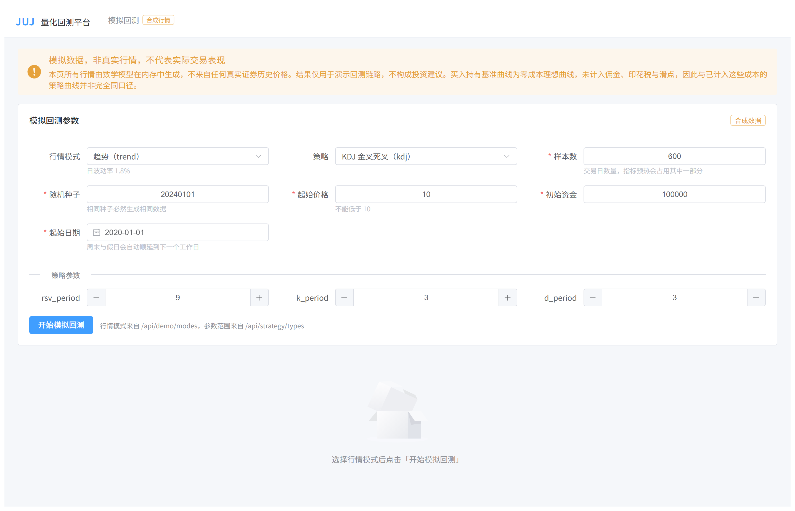
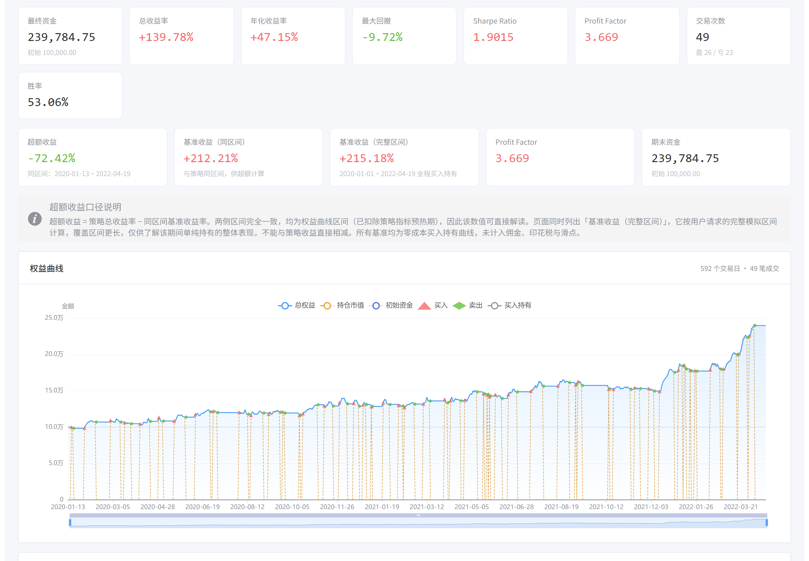
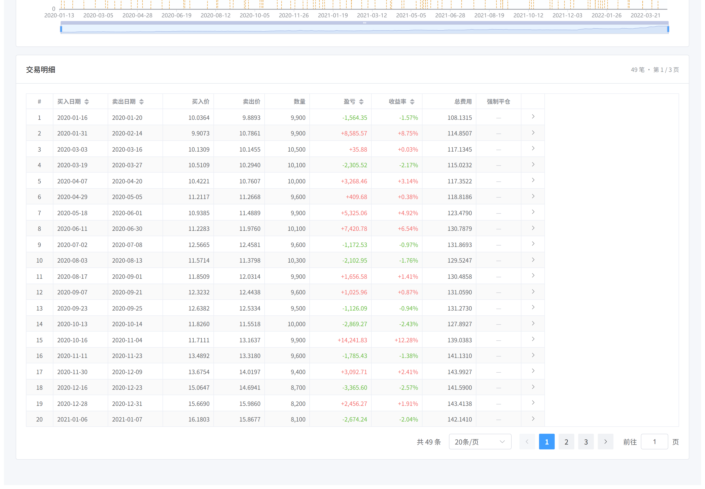

# JUJ · 合成行情回测 Demo

> **JUJ** 是一个用于演示与验证「策略回测」全链路的开源项目。
> 本仓库当前只提供**合成行情（模拟数据）**模式：行情由数学模型在内存中生成，
> 不接入任何真实证券数据源，不涉及实盘交易。

[](https://www.python.org/)
[](https://fastapi.tiangolo.com/)
[](https://vuejs.org/)
[](https://vite.dev/)

---

## 📸 截图

以下截图均取自本仓库代码的真实运行（合成行情，KDJ 策略 / 趋势模式 / 种子 20240101）。

### 参数配置

策略、行情模式、样本数与策略参数都在前端配置，参数范围由后端 `/api/strategy/types` 下发。



### 回测结果：指标与权益曲线

权益曲线（蓝）与买入持有基准（橙）对比，叠加每次买入 / 卖出点；下方另给出与基准的收益差口径说明。



### 交易明细

每一笔买卖的日期、成交价、数量、盈亏与浮动盈亏，可分页浏览。



---

## 🎯 这个项目解决什么问题

「写一个策略」和「知道这个策略靠不靠谱」之间隔着一整套回测基础设施：
行情数据、指标计算、信号生成、撮合与持仓、交易成本、绩效指标、可视化。

JUJ 把这套东西**完整地、可复现地、零外部依赖地**打包成一个可运行的 Demo，
让关注点回到策略本身，而不是环境搭建。

**关键特性：**

- **完全离线** —— 不需要数据库、不需要 Redis、不需要行情账号、不需要 API Key。
  克隆下来装完依赖就能跑。
- **完全可复现** —— 相同的 `(seed, mode, periods, start_date)` 必然生成**逐字节相同**的行情，
  回测结果因此可复现、可回归、可比对。
- **隔离性由测试保证** —— Demo 路径与「真实行情链路」在代码结构上物理隔离，
  并有测试用 AST 解析断言「Demo 模块绝不导入行情加载器 / 数据库 / 缓存」。
- **零成本模型** —— 计入佣金、印花税、滑点与整手约束，贴近 A 股实际成交规则。

---

## 🧩 功能

| 模块 | 说明 |
|---|---|
| **合成行情生成器** | 几何布朗运动（趋势）与 OU 均值回复（震荡）模型；三种行情模式：`trend` / `range` / `high_vol` |
| **回测引擎** | 信号 → 撮合 → 持仓 → 权益曲线；计入佣金、印花税、滑点、整手约束；支持协作式取消 |
| **策略系统** | 5 个内置策略：KDJ、均线交叉、布林带、RSI、MACD；基于 ABC 基类，易于扩展 |
| **绩效指标** | 总收益率、年化收益、最大回撤、夏普比率、胜率、盈亏比、交易统计 |
| **买入持有基准** | 同时计算零成本买入持有曲线，做同区间对比与超额收益计算 |
| **REST API** | `GET /api/demo/modes`、`POST /api/demo/backtest`、`GET /api/strategy/types`、`GET /api/health` |
| **Web 界面** | 参数表单、权益曲线 vs 基准对比、指标卡、交易明细表 |

### 内置策略与参数

| 策略 | 参数 | 默认值 |
|---|---|---|
| `kdj` | `rsv_period` / `k_period` / `d_period` | 9 / 3 / 3 |
| `ma_cross` | `fast_period` / `slow_period` | 20 / 60 |
| `bollinger` | `period` / `std_dev` | 20 / 2.0 |
| `rsi` | `period` / `oversold` / `overbought` | 14 / 30.0 / 70.0 |
| `macd` | `fast_period` / `slow_period` / `signal_period` | 12 / 26 / 9 |

---

## 🛠 技术栈

| 层 | 选型 | 版本 |
|---|---|---|
| 后端 Web | FastAPI + Uvicorn | 0.141.1 / 0.53.0 |
| 后端校验 | Pydantic | 2.13.5 |
| 数据计算 | pandas + NumPy | 3.0.6 / 2.5.3 |
| 前端框架 | Vue 3 + TypeScript | 3.5.44 / 6.0.3 |
| 前端路由 | vue-router | 5.4.0 |
| 前端 UI | Element Plus | 2.14.7 |
| 图表 | Apache ECharts | 6.1.0 |
| 构建 | Vite | 8.3.4 |
| 测试 | pytest + httpx | 9.1.1 / 0.28.1 |

---

## 🚀 快速开始

### 环境要求

> 以下版本是**本项目实际验证通过**的版本。
> 其他版本可能可用，但未经验证。

| 组件 | 要求 |
|---|---|
| Python | **3.14.3**（已验证） |
| Node.js | **22.22.2**（已验证） |
| npm | **10.9.7**（已验证） |

### 1. 启动后端

```bash
cd backend

python -m venv .venv

# Windows
.venv\Scripts\pip install -r requirements.txt
.venv\Scripts\python -m uvicorn demo_main:app --reload --port 8001

# macOS / Linux
.venv/bin/pip install -r requirements.txt
.venv/bin/python -m uvicorn demo_main:app --reload --port 8001
```

启动后：

- API 文档：<http://localhost:8001/docs>
- 健康检查：<http://localhost:8001/api/health>

> **关于入口：`demo_main:app`**
> `backend/demo_main.py` 是本仓库**唯一**的应用入口。它**不导入**数据库、缓存或行情加载器，
> 启动过程零外部依赖 —— 无需数据库、无需 Redis、无需任何行情账号或 API Key。
> 若你在别处看到 `main:app` 的启动说明，那属于带真实行情接入的完整版本，不在本仓库范围内。

### 2. 启动前端

```bash
cd frontend

npm install
npm run dev
```

浏览器打开 <http://localhost:5173>。

前端通过 Vite dev proxy 把 `/api` 转发到后端。默认目标是 `http://localhost:8001`，
与上面启动后端时使用的端口一致 —— **无需任何额外配置**。

若你把后端跑在其他端口，用环境变量覆盖：

```bash
# Windows (PowerShell)
$env:VITE_PROXY_TARGET = "http://localhost:8000"; npm run dev

# macOS / Linux
VITE_PROXY_TARGET=http://localhost:8000 npm run dev
```

### 3. 运行测试

```bash
cd backend
.venv\Scripts\pip install -r requirements-dev.txt
.venv\Scripts\python -m pytest tests -q
```

当前结果：**260 passed / 3 skipped**（跳过的 3 个是跨模块对照测试，
仅在包含完整版本的仓库中有意义）。

前端类型检查：

```bash
cd frontend
npx vue-tsc --noEmit
```

---

## 📖 使用示例

### 调用 API

```bash
curl -X POST http://localhost:8001/api/demo/backtest \
  -H "Content-Type: application/json" \
  -d '{
    "strategy_type": "kdj",
    "mode": "trend",
    "seed": 20240101,
    "periods": 600,
    "start_date": "2020-01-01",
    "parameters": {"rsv_period": 9, "k_period": 3, "d_period": 3}
  }'
```

响应中恒定包含以下标记字段：

```json
{
  "data_source": "synthetic",
  "is_demo": true,
  "disclaimer": "模拟数据，非真实行情，不代表实际交易表现",
  "mode": "trend",
  "seed": 20240101,
  "total_return": 0.13316232379983828,
  "total_trades": 25,
  "excess_return": 0.0513
}
```

### 在代码里调用

```python
from fastapi.testclient import TestClient
import demo_main

client = TestClient(demo_main.app)

response = client.post(
    "/api/demo/backtest",
    json={
        "strategy_type": "macd",
        "mode": "range",
        "seed": 42,
        "periods": 500,
        "start_date": "2021-01-01",
    },
)

result = response.json()
print(result["total_return"], result["total_trades"])
```

### 新增一个策略

策略只需继承 `engine.strategy.Strategy` 基类，实现 `generate_signals`：

```python
from engine.strategy import Strategy


class MyStrategy(Strategy):
    def __init__(self, period: int = 10):
        self.period = period

    def generate_signals(self, df):
        df = df.copy()
        df["ma"] = df["close"].rolling(self.period).mean()
        df["signal"] = 0
        df.loc[df["close"] > df["ma"], "signal"] = 1
        df.loc[df["close"] < df["ma"], "signal"] = -1
        return df
```

然后在 `engine/strategy_factory.py` 注册工厂分支、
在 `engine/strategy_validator.py` 的 `STRATEGY_SPECS` 中登记参数白名单。
**两处必须同时登记**，否则会出现「能选不能用」或「不能用却能选」。

---

## ⚠️ 重要声明

> ### 免责声明
>
> **本项目使用合成行情（模拟数据），不接入真实证券数据，也不提供实盘交易能力。**
>
> - 本仓库产生的所有回测结果均基于**数学模型生成的模拟数据**，
>   **不是任何真实证券的历史价格**，**不代表任何实际交易表现**。
> - 回测结果**不构成投资建议**，**不构成任何形式的收益预期或承诺**，
>   也**不保证未来收益**。
> - 历史回测表现与未来收益之间**没有必然联系**。
>   即使换成真实行情，策略同样可能亏损。
> - 任何依据本项目输出做出的投资决策，风险由决策者自行承担。
>
> 本项目仅供技术学习与研究用途。

---

## 🚧 当前限制

诚实地说明这个 Demo **做不到什么**：

| 限制 | 说明 |
|---|---|
| **无真实行情** | 只提供合成行情。没有数据源适配层，也不提供 Tushare 等接口的接入代码 |
| **无实盘交易** | 不含下单、券商接口、资金账户等任何实盘能力 |
| **单标的、单周期** | 每次回测针对一条合成价格序列，日线级别；不支持多标的组合与组合回测 |
| **无撮合深度** | 采用简化的撮合模型（按信号日的收盘价附近成交），不含盘口、冲击成本、涨跌停封板 |
| **无参数寻优** | 不含网格搜索、Walk-Forward、样本内外划分等优化框架 |
| **无持久化** | 不含数据库与缓存；每次请求独立计算，不保存策略配置与历史结果 |
| **无认证授权** | API 无鉴权，仅适合本地运行 |
| **单机单进程** | 回测计算在请求线程内同步完成，未做任务队列与分布式调度 |

---

## 📁 目录结构

```
juj-demo-release/
├── backend/
│   ├── demo_main.py            # 唯一入口：零外部依赖的 FastAPI 应用
│   ├── api/
│   │   ├── demo.py             # Demo API：/api/demo/backtest、/api/demo/modes
│   │   ├── json_utils.py       # JSON 安全清洗（Infinity/NaN → null）
│   │   └── schemas.py          # 共享响应模型与错误码
│   ├── engine/
│   │   ├── demo_data.py        # 合成行情生成器（GBM / OU）
│   │   ├── backtest.py         # 回测引擎
│   │   ├── strategy.py         # 策略 ABC 基类
│   │   ├── strategy_factory.py # 策略工厂
│   │   ├── strategy_validator.py # 策略白名单与参数校验
│   │   ├── metrics.py          # 绩效指标
│   │   ├── indicators.py       # 均线指标
│   │   └── *_strategy.py       # 5 个内置策略
│   ├── tests/                  # pytest 测试
│   └── requirements*.txt
├── frontend/
│   ├── src/
│   │   ├── api/                # API 客户端
│   │   ├── components/         # 表单、图表、指标卡、交易明细
│   │   ├── views/              # 页面
│   │   └── types/              # TypeScript 类型
│   ├── package.json
│   └── vite.config.ts
├── README.md                    # 项目说明（本文件）
├── LICENSE                      # Apache License 2.0 全文
├── NOTICE                       # 第三方版权声明
├── CONTRIBUTING.md              # 贡献指南
├── CODE_OF_CONDUCT.md           # 社区行为准则
└── SECURITY.md                  # 漏洞报告与安全策略
```

---

## 🤝 参与贡献

请阅读 [CONTRIBUTING.md](CONTRIBUTING.md)。
行为准则见 [CODE_OF_CONDUCT.md](CODE_OF_CONDUCT.md)。
漏洞报告方式见 [SECURITY.md](SECURITY.md)。

---

## 📄 许可证

本项目采用 **[Apache License 2.0](LICENSE)**（完整文本见仓库根目录的 `LICENSE` 文件）。

在 Apache-2.0 的条款范围内，你可以：

- **使用** —— 自由运行与学习本项目；
- **修改** —— 在遵循许可证条款的前提下修改源码；
- **再分发** —— 以源码或构建产物的形式分发本项目；
- **商业使用** —— 允许闭源商业衍生与收费分发。

该许可证还包含**显式的专利授权**，并要求保留版权与声明。

需要注意的两点：

- **第三方组件另有其许可。** 本项目使用了 ECharts（Apache-2.0）、zrender（BSD-3-Clause）
  等开源组件，其版权声明与许可义务见 [NOTICE](NOTICE)。
  使用这些组件须同时遵守它们各自的许可证条款。
- **Apache-2.0 不授予商标许可。** 许可证第 6 条明确不授予许可方商标、服务标记或产品名的使用权限，
  仅允许为合理描述作品来源而使用。因此本许可证**不包含对 JUJ 名称或标识的授权**；
  第三方不得使用 JUJ 名称暗示官方背书或从属关系。

贡献代码即表示你同意以 Apache-2.0 授权该贡献（详见
[CONTRIBUTING.md](CONTRIBUTING.md)）。

---

## 📌 致谢

- [FastAPI](https://fastapi.tiangolo.com/) · [Pydantic](https://docs.pydantic.dev/)
- [pandas](https://pandas.pydata.org/) · [NumPy](https://numpy.org/)
- [Vue](https://vuejs.org/) · [Element Plus](https://element-plus.org/)
- [Apache ECharts](https://echarts.apache.org/)
- [Vite](https://vite.dev/)
